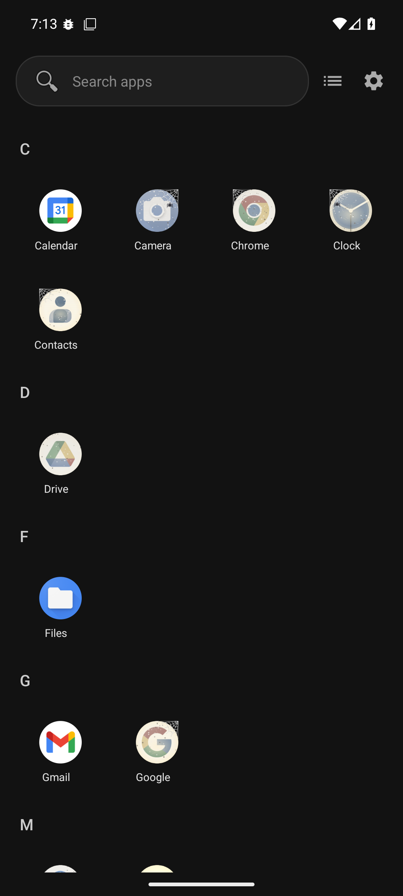
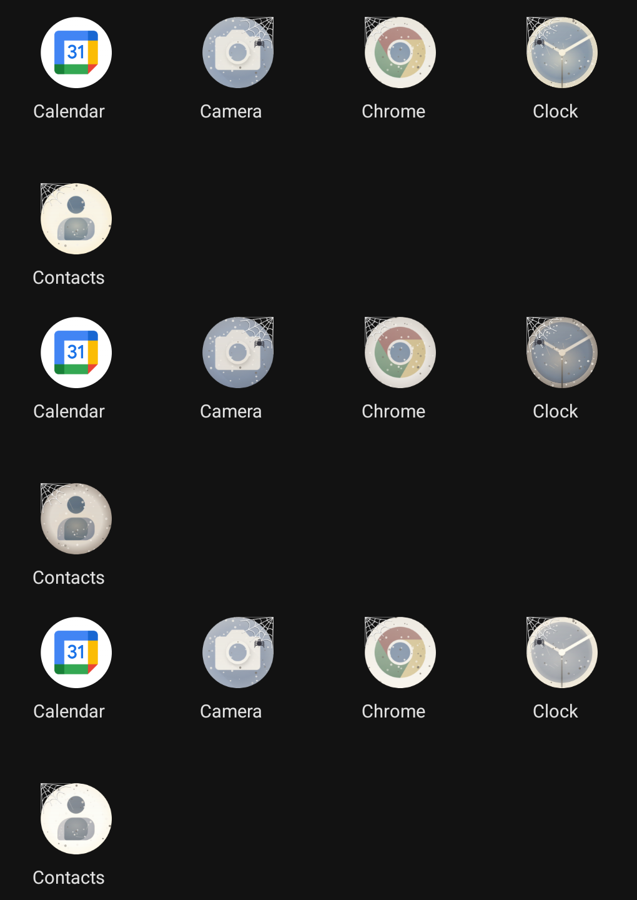

# Lived-in: a launcher whose icons age with use

Branch `lived-in`. App icons show how you treat them, the way a well-used tool or a
forgotten shelf does:

- **Icons you use a lot get a patina.** They go slightly warm and flat, like handled brass. A
  thumb-polished sheen sits a little below centre, where a finger lands. The rim wears lighter,
  and the most-used ones pick up a few fine scuffs.
- **Icons you leave alone get dusty.** A grey film settles, heavier at the top, with soft speckles,
  and the colours dim and grey out.
- **Icons left for a month grow a cobweb** across one top corner, in the gap a round icon leaves.
  After two and a half months a small spider moves in.
- **Launching a dusty icon blows the dust off.** When you come back to the launcher, the dust and
  web fade while a little cloud lifts off the icon.



| | |
|---|---|
|  | The puff, frame by frame from the emulator (Chrome in the dock, Time-lapse mode) |
|  | The same icons in Brass, Leather and Keepsake, top to bottom |

Like Wobble (branch `generic-launcher-wobble`, `WOBBLE.md`), this is a whim the launcher you rent would never ship. Here it
fits behind the personality seam with a small spine diff.

## See it

```
./dev-debug.sh build
```

It installs as **"Lived-in Debug"** (`com.genericlauncher.livedin.debug`), next to the generic
launcher and Wobble rather than over them. Press Home and pick it.

**A fresh install looks normal, on purpose.** Nothing has had time to age. To see the effect at
once, open the drawer, then **Settings → LIVED-IN → Icons age with use → Time-lapse demo**. That
gives every app an invented history: some well-worn, some dusty, some cobwebbed. Then **a day
passes every real minute**, so the clean ones gather dust while you watch. The screen re-checks
every 4 seconds. Tap a dusty icon, come back, and watch the puff. Picking Time-lapse again restarts
the demo from its invented history.

## The variants (Settings → LIVED-IN)

| Setting | What it does |
|---|---|
| **Off** | Icons as the platform draws them. |
| **Patina only** | Wear from use, no dust. The gentlest option. |
| **Dust & cobwebs only** | Neglect shows, use doesn't. |
| **Full lived-in** (default) | Both. An app that was loved and then abandoned shows both: worn *and* dusty. |
| **Time-lapse demo** | Full, with an invented history per app and a clock running 1440× (one minute = one day). Launches count 10× toward patina. |

| Wear style | Look |
|---|---|
| **Brass** (default) | Warm and burnished, with a golden sheen and lighter edges. |
| **Leather** | Darker and browner, with the rim rubbed dark. |
| **Keepsake** | Sepia-faded with cream edges, like an old photograph. |

**Use Android's usage history** opens the system Usage access screen; once granted, time spent in
apps opened from anywhere counts toward wear, and the row reads "Usage history: on".

**Forget usage** wipes the launch log, after a confirmation. Every icon then starts fresh from today.

The style only changes how *patina* looks; dust and cobwebs are the same in every style. On the
emulator screenshots, where most icons are dusty, the styles therefore differ only subtly.

## How age is measured

- **The launcher records its own launches.** Every launch from the drawer, home page, dock or
  folder goes through `AppAdapter.launchApp`/`launchPackage`. It records a count and a
  last-launched time per app key, in its own SharedPreferences file (`livedin_launches`). No
  permission is needed. Work-profile apps have their own keys (`pkg#serial`).
- **Usage Access adds to it if granted.** The USAGE drawer mode's foreground time is folded in at
  3 minutes ≈ 1 launch. Nothing depends on it.
- **"Idle" never counts from before the launcher could have seen the app.** It runs from the
  latest of: the last launch, the launcher's own install time (frozen on first run), and the app's
  install time. So a fresh install shows nothing aged, and an app installed last week is not
  cobwebbed on arrival.

| | Threshold |
|---|---|
| Patina 1 / 2 / 3 | 8 / 25 / 80 uses |
| Dust 1 / 2 / 3 | 4 / 10 / 21 days idle |
| Cobweb / with spider | 30 / 75 days idle |

The thresholds are in `Wear.java`, and `WearTest` pins them.

## How it's built

A sixth seam, `personality/IconTreatment`, makes this possible. `DrawerItemDecorator` only reaches
the drawer, and the home screen draws raw platform drawables (as `docs/SEAM.md` notes), so an icon
look that must match on every surface had nowhere to live. `IconTreatment.treat(context, icon, key)`
is called at all four icon sites, and the result is wrapped in the notification badge, so the
badge never gets dusty. The seam's `onLaunched`, `onResume` and `onPause` hooks tell it about use.
Its default, `NONE`, returns the icon unchanged.

| File | Role |
|---|---|
| `livedin/Wear.java` | Pure maths: variants, styles, bucketing, the time-lapse history. Packs a look into an int. |
| `livedin/LaunchLog.java` | The launch log, with an injectable clock for tests. |
| `livedin/LivedIn.java` | The `IconTreatment` and `AppDataSink` implementations, the settings, and the live-drawable registry. |
| `livedin/LivedInDrawable.java` | One icon on one surface. Draws a cached bitmap, or the raw icon when pristine. Plays the puff. |
| `livedin/WearPainter.java` | Renders a look (colour matrix, sheen, dust, cobweb) and the puff particles. |
| `Personality.java` (both flavours) | `ICON = LivedIn.TREATMENT`. `DATA` gathers install and foreground times off the main thread. |
| Spine | 4 `treat()` call sites, 2 `onLaunched` lines, `onResume`/`onPause` in `MainActivity`, `BadgeDrawable` forwarding invalidations from its base, and the settings rows. |

**Performance.** Looks are quantised (4 patina × 4 dust × 3 cobweb levels). Each app × look ×
style × pixel size is rendered once into a bitmap and kept in a shared 12 MB `LruCache`. A frame
then costs one `drawBitmap`, and a pristine icon draws straight through. `draw()` allocates nothing
except when a look changes (a cache miss renders the bitmap). The puff draws its particles from a
seeded hash, with no per-frame allocation, and schedules its frames with `scheduleSelf`. An
`invalidateSelf()` from inside `draw()` is lost when display-list recording ends, and the first
emulator build's puff froze on its first frame for exactly that reason. On resume every live icon
re-derives its look and only the changed ones redraw.

**A setting in an "edit code, not settings" base.** `docs/SEAM.md` says taste should be a diff,
not a toggle. This branch adds settings anyway, because the point is to compare variants side by
side on a phone. A fork that liked one would delete the switch and hard-code it.

## Rough edges

- The puff only plays if the launcher is back in front within 2.5 s of resuming (`PUFF_WINDOW_MS`).
  It is held for 300 ms first, because the closing app's window animation still covers the
  launcher. On a slow device the puff could start under that animation.
- The cobweb's two anchor threads run along the bounding box's top and left edges. On a square
  icon they read a little like a frame corner.
- `onLaunched` records the tap even if the launch then fails, for example when the app was
  disabled since the list loaded.
- The folder *chip* on the home page (the mini icon grid on a folder) is not treated, but folder
  popups are.
- Not driven on a physical phone. Only on the API 36 emulator, through the screenshots in
  `docs/livedin/`.
